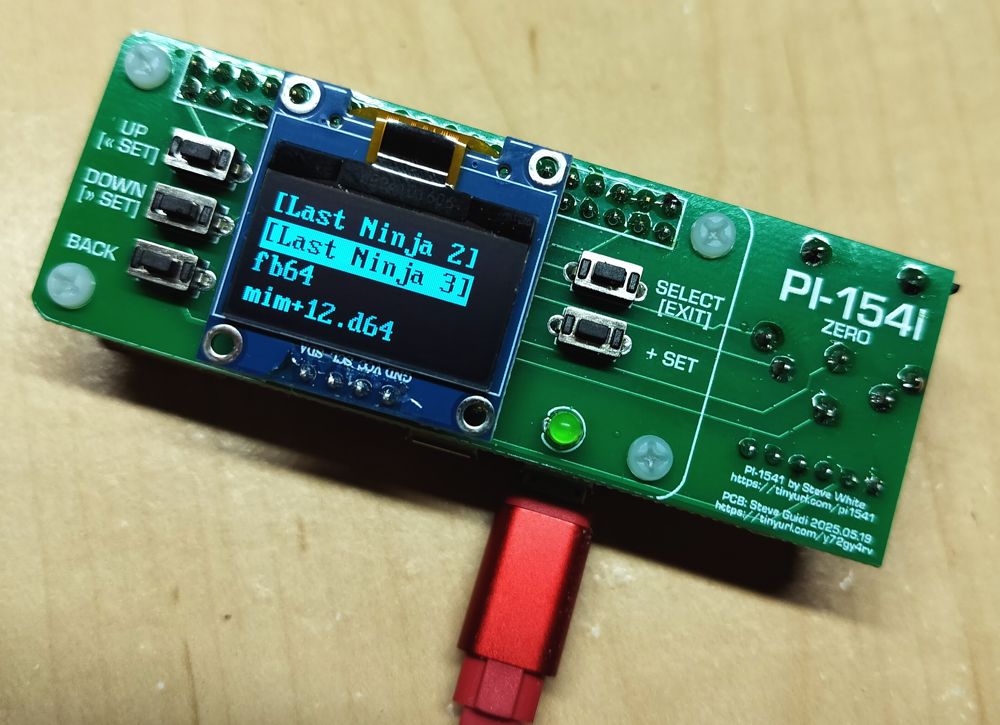
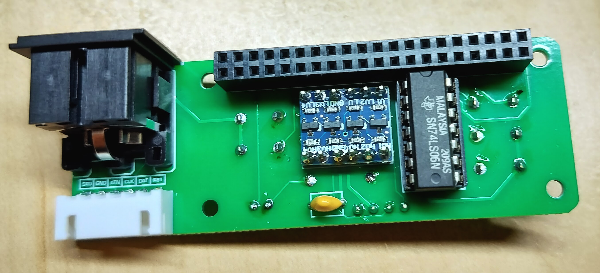

# pi1541-zero


## Overview
This module is an implementation of the [Pi1541](https://cbm-pi1541.firebaseapp.com/): a cycle-exact Commodore 1541/1581 emulator by Steve White, which functions in conjunction with a Raspberry Pi.  The "hat" has a form factor that is similar to the Zero series, though it may be used with any supported Raspberry Pi board and with an appropriate GPIO riser (when applicable).  Please review the [Pi1541](https://cbm-pi1541.firebaseapp.com/) project documentation for a list of supported devices.

The PI1541-Zero module has a small form factor, similar to the Raspberry Pi Zero series (Zero, Zero W, Zero 2, etc...) while also implementing the "Option B" or "7406" schematic.  This implementation allows the PI1541 to communicate with your Commodore 8-bit computer and also function with other devices connected to the serial bus.  You may use an existing serial cable to connect the Pi1541-Zero to the computer or another device on the serial bus (1541, 1581, printer, etc...).  The female JST-XH pin header also exposes the serial bus for additional serial connections (via a custom cable).

The buttons for the PI1541-Zero follow a logical layout and are clearly labelled with their functionality.  You may hold the device like a modern game controller, using your thumbs to navigate the menu system and select files.  A green LED on the module signals both device activity and status, similar to many Commodore disk drives.

This repo contains the module schematics, bill of materials, and gerber files so that you can make your own hardware.

## Assembly Notes

Please note that the PCB has components installed on both sides and relies on the GPIO header clearance for isolation between components and the Raspberry Pi host.  A study of the components and final assembly images before soldering is encouraged!  The OLED screen is soldered over several resistors, and it is recommended to place a layer of double-sided foam tape between the screen and resistors to mitigate any pressure the screen may receive from the surface.



The following image shows an assembled Pi1541-Zero among a Raspberry Pi and accessories.  Spacers are not required for final operation, nor is a JST XH->DIN-6 serial cable (if an existing Commodore serial cable is available).


## Firmware Installation
Please review the firmware installation instructions on the [Pi1541 project page](https://cbm-pi1541.firebaseapp.com/) that are specific to your Raspberry Pi hardware.  The instructions essentially involve copying a custom kernal image and config file from the Pi1541 project page to an SD card, the DOS kernals for the 1541 or 1581 from the VICE project, as well as several boot files from the Raspberry Pi Foundation web site.  An example of the procedure for the Raspberry Pi Zero is thoroughly documented in [this YouTube video](https://www.youtube.com/watch?v=8Gs1daxDKa8) from The LEEC.

Modification of the default `options.txt` file is required for proper operation of the PI1541-Zero.  This file configures the PI1541 to share the serial bus, configures the OLED screen orientation, and enables the LED.  Please refer to this [gist](https://gist.github.com/SteveGuidi/bd2c40a72a575f7b349c9c07aa530167) for a pre-configured `options.txt` files as well as an overclocking configuration for use with the Raspberry Pi Zero and Zero W.

Note that the key differences between the default options.txt and the one required for this hat are the following:

```
splitIECLines = 1
LCDName = ssd1306_128x64
i2cBusMaster = 0 //SDA - pin 27 SCL - pin 28
i2cLcdFlip = 1
```

Of importance are `splitIECLines=1` to enable multiple devices on the serial bus ("Option B") and `i2cBusMaster=0`.  The default comments state `i2cBusMaster=0` is for "Option A" implementations, but the OLED screen is indeed connected to the given Raspberry Pi pins in the comment.

---
Shield: [![CC BY-SA 4.0][cc-by-sa-shield]][cc-by-sa]

This work is licensed under a
[Creative Commons Attribution-ShareAlike 4.0 International License][cc-by-sa].

[![CC BY-SA 4.0][cc-by-sa-image]][cc-by-sa]

[cc-by-sa]: http://creativecommons.org/licenses/by-sa/4.0/
[cc-by-sa-image]: https://licensebuttons.net/l/by-sa/4.0/88x31.png
[cc-by-sa-shield]: https://img.shields.io/badge/License-CC%20BY--SA%204.0-lightgrey.svg
